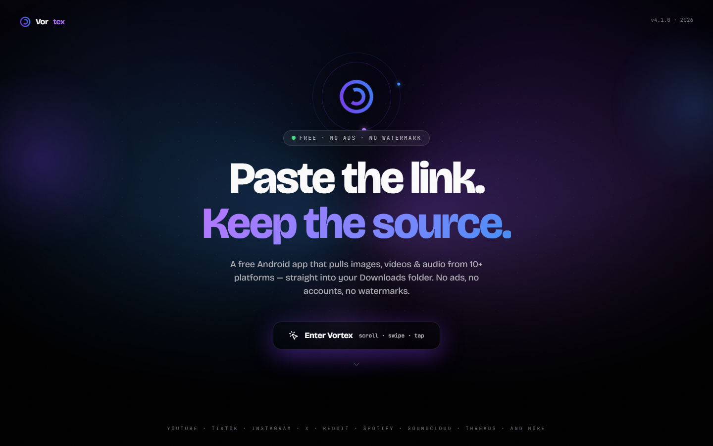

# Vortex site

Landing page for Vortex, a free Android app that saves images, video and audio from links on YouTube, TikTok, Instagram, X, Reddit, Spotify, SoundCloud and Threads to the Downloads folder. No ads, no accounts, no watermarks.

[Live site](https://vortex-site-pi.vercel.app)



## Page structure

Preloader and splash, hero, how it works, showcase, stats, supported platforms, FAQ, waitlist form, footer. Smooth scrolling with Lenis, a custom cursor and an ambient background.

## Stack

React 19, Vite, Tailwind CSS 4, Framer Motion, Lenis, Radix UI (accordion), Sonner, Lucide icons.

## Develop

```bash
npm install
npm run dev        # http://localhost:5173
npm run build      # output in dist/
npm run preview
```

Vercel detects the Vite build (`vite build`, output `dist`) without configuration.

## Waitlist form

The form validates input and confirms the signup on the client only. There is no backend, so nothing is stored, and the page shows no signup counter. To collect real signups, send the email to a form service or API in `src/components/vortex/download.jsx`.